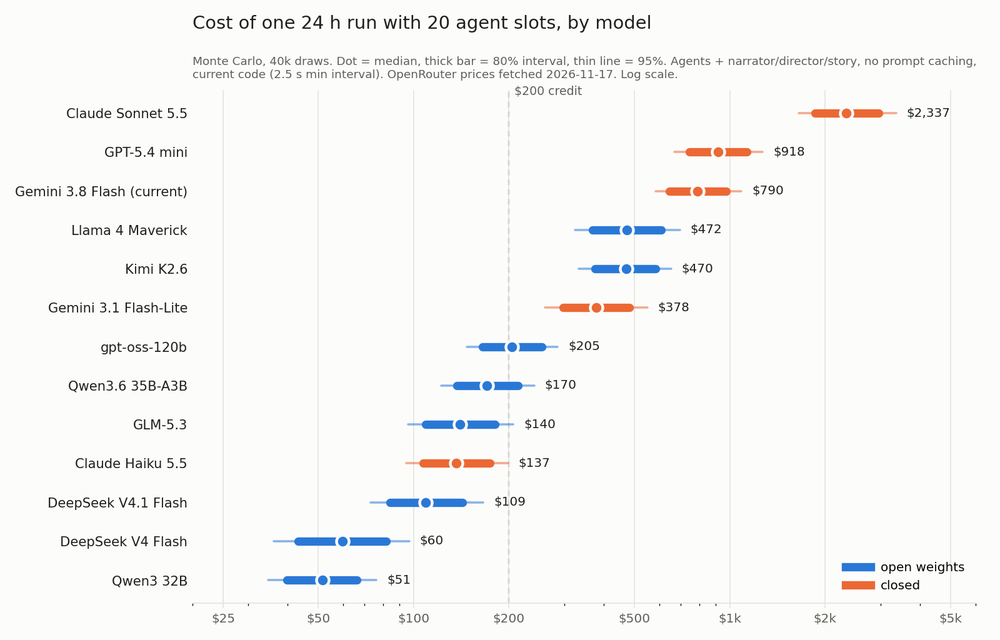

# Compute cost model (2026-11-17)

Monte Carlo cost model for the study. Scripts: `analyze.py` (measures our logs -> `measured.json`), `model.py` (Monte Carlo -> `results.json`, `model_output.txt`, `tables.md`), `chart.py` (-> `cost-24h-20slots.png`). OpenRouter prices fetched live 2026-11-17; GPU prices from runpod.io/pricing and lambda.com/pricing.

## Measured (Gemini 3.8 Flash, clean pre-402 windows of two runs)
- $1.29-1.41 per agent slot-hour; ~335 calls/slot-hour; $0.004/call. Prompt ~2.9k tokens; completion ~500 tokens of which ~90% hidden reasoning.
- No prompt-cache discount today (Gemini/Claude need explicit `cache_control` via OpenRouter).
- Cadence is set by provider latency (~6.4 s) + action time (~3.3 s), not the 2.5 s floor, so **faster models make more calls and act more often in game time**: a cost driver and a scientific confound. Fix the minimum interval at 8-10 s in every condition.
- Narrator/director/story overhead scales with population: ~$68/day at 20 alive on Gemini Flash.
- Cost scales with agent slots x hours (slots are reborn), not with births.

## 20 slots x 24 h (median [95% CI]), current code, no caching
Qwen3-32B API $51 [35-76] · DeepSeek V4 Flash $60 [36-97] · DeepSeek V4.1 Flash $109 · Claude Haiku 5.5 $137 [95-199] · GLM-5.3 $140 · Qwen3.6 35B-A3B $170 · gpt-oss-120b $205 · Gemini 3.1 Flash-Lite $378 · Kimi K2.6 $470 · Llama 4 Maverick $472 · **Gemini 3.8 Flash (current) $790 [582-1,089]** · GPT-5.4 mini $918 · Claude Sonnet 5.5 $2,337.
Model choice spreads cost ~45x; within a model the 95% range is ~2x. Non-Gemini models are priors (reasoning length, latency) until calibrated with ~15-min runs.

## Self-hosted persona-vector steering
Qwen3-32B FP8, no thinking, 20 slots at 10 s cadence fits one H100: ~$74/day (RunPod community) / $121 (secure). Thinking mode doubles GPUs. Mixed per-agent vectors in one vLLM batch are feasible (per-token gather+add; EasySteer reports 71-91% throughput) — verify per-request vectors or write a ~50-line hook. Steering prompt tokens makes prefix KV vector-specific (use per-request `cache_salt`). Steering is cost-competitive with prompted DeepSeek/Haiku via API, so (A) prompted vs (B) steered is a scientific choice, not a financial one.

## Levers (Gemini, share saved)
Flex tier ~61% (best-effort) · static-prefix restructure + caching 25% · event-driven calls 25% · shorter observations 17% · no-LLM babies 10% · combined ~49%. Reasoning-off only saves with a fixed cadence (otherwise more calls). Move narrator/director to a cheap model: ~$62/day.

## Run-length planning
Budget allocation is kept privately (docs/private/, gitignored). With a compute budget B, long-run days ≈ (B − pilots − contingency − 3×24h runs) / $-per-day for the chosen model (see tables).

See `tables.md` for 80% intervals, caching-on figures and per-model calls/slot-hour.
